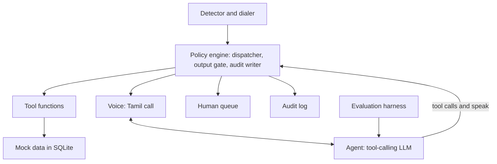
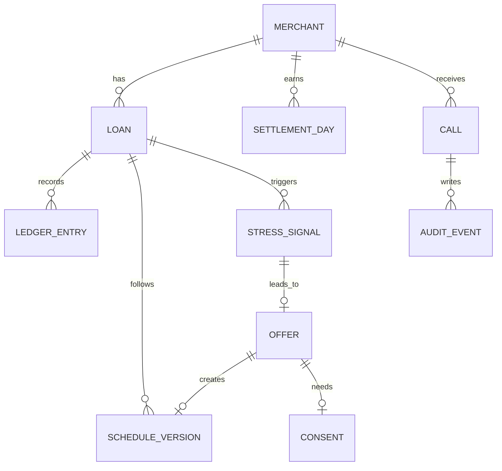

# Architecture: Keel

Status as of 14 Nov 2026: design for the hackathon demo. The core is built and tested, Keel's lines have cached Tamil audio, and a recorded backup video exists; live speech-to-text is not built. The demo builds stage 3 only (spot stress early, call, relief). Stages 1 and 2 are pitched, not built.

## The stack

The policy engine runs in-process and is the only way to reach data or take an action. Every spoken sentence also goes through it before text-to-speech.

| Component | Choice | Role |
|---|---|---|
| Detector and dialer | A scheduled Python job | Applies the lender's stress rule to settlements, then asks the policy engine for permission to call. The calling-window check lives here |
| Voice | Sarvam text-to-speech (`bulbul:v3`, Tamil) with pre-generated, cached audio for Keel's lines; text chat for the merchant; a recorded run in `backup/` as the last-resort backup. Live speech-to-text and a LiveKit or Pipecat call loop are not built | Plays Keel's lines in Tamil and carries the merchant's text |
| Agent | Sarvam `sarvam-105b` through its OpenAI-compatible chat API, with tool calling; a scripted agent is the fallback | Decides what to say and which tool to call. Does not compute offers or decide eligibility |
| Policy engine | In-process Python module | The single dispatcher for tools. Computes offers from the lender envelope. Runs the output gate before speech. Routes handovers. Writes the audit log. The model never reaches the tools directly |
| Tool functions | Plain Python functions with an MCP-shaped signature (name, typed arguments, structured result) | Read settlements, propose an offer, record consent, apply a schedule, raise a handover. There is no separate MCP server; the shape allows one later, or a Paytm MCP server on the day |
| Storage | SQLite | Holds the data models below |
| App | FastAPI backend and one static HTML page (no build step, works offline): call, schedule, handover queue, audit with verify, results | The demo surface |
| Evaluation | About 60 text-mode scenarios generated from templates, kept in YAML; attack scenarios use a scripted misbehaving model | Produces the numbers on the results dashboard |

**How the design enforces the rules**
- **One choke point.** The agent calls tools only through the policy engine. A blocked call is logged with the rule that blocked it.
- **Output gate.** The agent speaks through a `speak` action. Rupee figures are filled from tool output through templates, and a number-audit runs at runtime before the text goes to speech. If a figure doesn't match, the sentence is blocked and the case escalates. Free-form Tamil wording around the figures is not verified.
- **Confirmation by the engine, not the model.** To apply a relief offer, the engine speaks a fixed read-back and waits for an explicit "yes". It then writes the consent record itself. A minimal identity check (last four digits of the registered phone) runs before loan details are disclosed.
- **Handover.** It goes through the policy engine and is logged. A deterministic backstop escalates on distress keywords or after repeated policy blocks, so a model miss does not fail open.
- **Offers and eligibility** are computed in deterministic code. The model explains the result.
- **Money** is integer rupees. Field names carry the unit.
- **Calling window** defaults to 08:00 to 19:00, as configuration. The reported RBI recovery-call limit has disputed effective dates; verify against the RBI text.
- **Mocked services.** Everything is mocked. The demo mocks only what it shows: the schedule change, and (as a stretch) a UPI payment link and a ticket. WhatsApp and SMS are log lines. If the Paytm sandbox is offered on the day, it replaces a mock behind the same function signature (unconfirmed).

**Open decisions (owner to be named; all to be closed today)**
1. Decided: the agent model is Sarvam `sarvam-105b` (Claude or Gemini were the alternatives).
2. Whether a live speech-to-text call loop (LiveKit or Pipecat) is worth building before the event.
3. Who checks the Tamil lines and the generated audio.
4. Whether the Sarvam model names in the docs are current (the docs were inconsistent).

## The data models

Amounts are integer rupees, and field names end in `_rupees`. The lender envelope and the eval scenarios are YAML files, not tables.

**Merchant**: merchant_id, name, trade, city, language ("ta"), phone (synthetic, redacted in logs), normal_daily_settlement_rupees (a fixed seeded constant for the demo; 4,000 for the hero merchant).

**Loan**: loan_id, merchant_id, principal_rupees (200,000), status (active, relief, closed). The loan has no stored daily amount, end date or balance. They are derived from the schedule and the ledger.

**SettlementDay**: merchant_id, loan_id, date, settlement_rupees.

**LedgerEntry** (what was actually collected): entry_id, loan_id, date, amount_rupees, kind (scheduled, upi_link, adjustment). The balance is the principal minus the sum of ledger entries, so it cannot drift.

**ScheduleVersion**: loan_id, version, daily_amount_rupees, starts_on, ends_on (null for open-ended), offer_id (null for the original), created_by.
- The schedule for a date is found by date range, not by editing old rows.
- `UNIQUE(offer_id)` on the relief row (v2) stops a retried or double-accepted offer creating two versions. v3 has no `offer_id`. A `kind` column marks each row original, relief or resume.
- For the example: v1 is Rs 500 from the start; v2 is Rs 300 for 14 days from day 6; v3 resumes Rs 500 until the balance is cleared.
- The last instalment is `min(daily_amount, remaining_balance)`, so the Rs 2,800 deferral ends with five repayments of Rs 500 and one of Rs 300, and the loan ends 6 days later.

**Lender envelope** (versioned YAML, loaded by the policy engine)

| Field | Example | Meaning |
|---|---|---|
| envelope_id | env-1 | Referenced by every signal and offer, so a replay reproduces the rules in force |
| stress_threshold_pct | 75 | Settlement below this share of normal counts as a low day |
| stress_consecutive_days | 2 | Low days in a row that trigger a signal |
| min_daily_amount_rupees | 300 | Lowest allowed daily repayment under relief |
| max_relief_days | 14 | Longest allowed relief period |
| max_extension_days | 7 | Longest the loan end date may move |
| call_window | 08:00 to 19:00 | Allowed calling hours |
| requires_consent | true | Consent must be on record before a schedule changes |

**StressSignal**: signal_id, loan_id, detected_on, low_days (dates and percent of normal), normal_daily_settlement_rupees (snapshot), envelope_id (snapshot). No new signal fires while a relief schedule is active.

**Offer**: offer_id, signal_id, call_id, envelope_id, new_daily_amount_rupees (300), relief_days (14), deferred_rupees (2,800, derived), extension_days (6, derived), within_envelope (set by the engine), status (proposed, accepted, declined, escalated).

**Consent**: consent_id, merchant_id, offer_id, text_hash (hash of the exact read-back spoken), granted_at, revoked_at (null if active), transcript_span. Written by the policy engine after an explicit yes, never by the model.

**Call**: call_id, merchant_id, started_at, language, transcript_ref, identity_verified (bool), outcome (resolved, declined, escalated, no_answer), autonomous (bool, for the resolution metric), escalation_reason (null, DISTRESS, DISPUTE, OUT_OF_ENVELOPE, LOW_CONFIDENCE, POLICY_BLOCK), handover_summary (short and factual).

**AuditEvent** (append-only and tamper-evident)

| Field | Notes |
|---|---|
| seq | Monotonic sequence number |
| timestamp | UTC |
| call_id | Nullable, because detector events happen before any call |
| loan_id, merchant_id | Always set |
| actor | agent, policy_engine, detector, human |
| action | tool call, policy decision, consent, offer, speech block, escalation |
| inputs, result | Redacted by the writer before the row is stored |
| rule_id | The rule that allowed or blocked the action, if any |
| prev_hash, hash | Hash chain over the rows. The audit view has a "verify" button that recomputes it |

SQLite triggers abort any `UPDATE` or `DELETE` on this table. Redaction happens in the writer, because rows cannot be changed afterwards.

**Evaluation scenarios** (YAML, not a table): scenario_id, category (normal, unclear_or_declined, angry_borrower, out_of_hours, adversarial, known_gap), agent (flow or attack), input, expected_outcome, expected_escalation_reason. Per-run results: autonomous (bool), escalation_reason, violation_blocked_by_rule, number_audit_pass. The roll-rate simulation was dropped.
