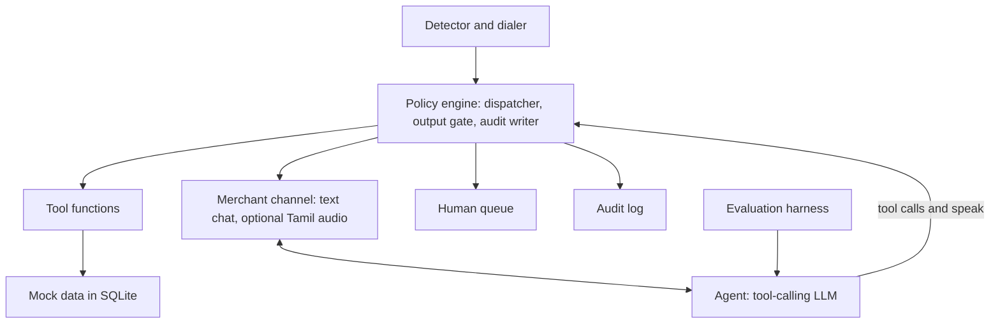

# TRD: Keel (Technical Requirements Document)

Team JustUs, Paytm Build for India AI Hackathon (Chennai), Track 2.
Companion documents: `PRD.md` (what and who), `ARCHITECTURE.md` (stack and data models).
Status as of 14 Nov 2026: requirements for the demo build. The core is built and tested (policy engine, audit log, detector, scripted and model-driven agent, screen, scenario run, cached Tamil audio for Keel's lines, recorded backup video). Live speech-to-text and a live voice call are not built. The event is on 15 Nov, so every requirement is marked **Must** (the golden path fails without it), **Should** (the demo is weaker without it) or **Could** (only if time remains).

## 1. Scope

**Built for the demo:** stage 3 of the journey. The detector flags a fall in a merchant's settlements, the agent phones the merchant in Tamil, offers a relief schedule inside the lender's limits, confirms it, applies it, and logs everything. One case is escalated to a human.

**Not built:** stage 1 (pre-offer, Key Fact Statement, cooling-off), stage 2 (e-mandate, disbursal), real Paytm or bank integrations, real money movement, real borrower data, languages other than Tamil, WhatsApp and SMS delivery.

**Reference case (all tests and the demo use it).** Hero merchant Murugan: loan Rs 2,00,000, repayment Rs 500 a day, normal daily settlement Rs 4,000, settlements Rs 4,000, 3,800, 3,300, 2,900, 2,500, 2,400, 2,400 on days 1 to 7. These are illustrative assumptions, not Paytm's real terms.

## 2. System architecture

This section shows how the parts fit together. The full data models (fields, tables, the lender envelope) are in `ARCHITECTURE.md`. The requirements in section 3 apply to the parts below.

### 2.1 Component diagram



### 2.2 Components

| Component | Responsibility | Built with | Requirements |
|---|---|---|---|
| Detector and dialer | Applies the stress rule to settlements, asks the policy engine for permission to call, checks the calling window | Scheduled Python job | F1 to F4 |
| Merchant channel | Carries the conversation. Text chat is the baseline. Keel's lines are spoken in Tamil from pre-generated audio; live speech-to-text is not built | Text adapter; Sarvam text-to-speech (`bulbul:v3`) | F5, F6, F8, F9 |
| Agent | Decides what to say and which tool to call. Does not compute offers or decide eligibility | Sarvam `sarvam-105b` (OpenAI-compatible chat API) with tool calling | F7 |
| Policy engine | The single dispatcher for tools. Computes and checks offers, captures consent, gates every spoken sentence, routes handovers, writes the audit log | In-process Python module | F10 to F24 |
| Tool functions | Read settlements and schedules, propose and apply relief, raise a handover | Plain Python, MCP-shaped signatures | Section 4.1 |
| Human queue | Holds escalated cases with a summary and a link to the audit trail | FastAPI endpoint and web view | F23, F24 |
| Audit log | Append-only, hash-chained record of every decision | SQLite with triggers | F25 to F28 |
| Evaluation harness | Runs the scripted scenarios against the real agent and policy engine | Python, YAML scenarios | F29 to F31 |
| Storage | Mock merchants, loans, settlements, schedules, offers, consents, calls, audit events | SQLite | N6 |
| App | Shows the schedule change, the audit view, the human queue and the results | FastAPI backend; web page | F16, F28, F31 |

### 2.3 Golden-path flow

1. **Detect.** The detector reads settlements and applies the stress rule. For the reference case a signal fires after day 5 (F1 to F3).
2. **Permission.** The dialer asks the policy engine whether it may call. Outside the calling window the call is refused and logged (F4, R1).
3. **Identify.** The merchant passes the last-four-digits phone check before any loan detail is spoken (F5, R9).
4. **Offer.** The agent asks for a relief offer. The engine computes it from the lender envelope and checks it (F10, F11). The agent never calculates a figure.
5. **Speak.** The agent speaks through templates. The output gate runs the number-audit before anything is said (F7, F18).
6. **Confirm.** The engine speaks a fixed read-back and accepts only an explicit yes. It then writes the Consent record (F12, F13).
7. **Apply.** The engine adds the new schedule versions. The screen shows the old and new schedule and the new end date (F14 to F16).
8. **Record.** Every step above is an audit event on the hash chain (F25 to F27). At any step a distress, dispute, out-of-limit request, low confidence or repeated block hands the case to the human queue (F21 to F24).

### 2.4 Trust boundaries

- The agent can only call tools through the policy engine. There is no other path to data or actions (F17).
- The agent cannot write a rupee figure, set `within_envelope`, record consent or reject a loan. Those belong to code the model does not control (F7, F11, F13, F19).
- A deterministic backstop covers cases the model misses: distress keywords and repeated blocks escalate on their own (F22).
- The audit log cannot be edited through the app, and any outside edit breaks the hash chain (F26, F27).

### 2.5 What is real and what is mocked

| Real in the demo | Mocked in the demo |
|---|---|
| Detector, offer maths, schedule versions, the policy engine and its rules | Merchants, loans and settlements (synthetic) |
| The audit log and its hash chain | Paytm and bank systems, money movement, the e-mandate |
| The LLM tool-calling loop (and Sarvam speech if it runs) | WhatsApp and SMS (log lines), UPI payment link, tickets |
| The scripted scenario run and its three figures | The Paytm sandbox, unless it is offered on the day |

## 3. Functional requirements

### 3.1 Detection and calling

| ID | Priority | Requirement |
|---|---|---|
| F1 | Must | The detector reads daily settlements and applies the lender envelope's stress rule. A day is low when `settlement_rupees * 100 < stress_threshold_pct * normal_daily_settlement_rupees`. A signal fires after `stress_consecutive_days` low days in a row. For the reference case it fires after day 5 (day 4 is 72.5%, day 5 is 62.5%, day 3 at 82.5% is not low). |
| F2 | Must | No new signal fires while a relief schedule is active on the loan. |
| F3 | Must | Each signal stores a snapshot of the normal level and the `envelope_id` in force, so a replay reproduces the decision. |
| F4 | Must | The dialer asks the policy engine for permission before starting a call. Calls outside the calling window (default 08:00 to 19:00) are refused and logged. |
| F5 | Must | Before any loan detail is spoken, the merchant passes a minimal identity check (last four digits of the registered phone). Failure ends the call and logs the failure. |

### 3.2 The conversation

| ID | Priority | Requirement |
|---|---|---|
| F6 | Must | Keel's lines are spoken in Tamil. Audio is generated ahead of time with Sarvam text-to-speech and cached (`data/audio`, `scripts/make_audio.py`), so playback needs no network. The merchant's side is text in the demo; live speech-to-text is not built. |
| F7 | Must | The agent explains the situation and the offer in plain Tamil. All rupee figures are filled in from tool output through templates. The model never writes a figure itself. |
| F8 | Must | A **text-mode** version of the same flow runs without audio, for evaluation and as a fallback. |
| F9 | Should | A **recorded** run exists as a last-resort backup: `backup/Keel_demo_backup.mp4` (about 100 seconds: the Tamil call with audio, the schedule change, one escalation, the audit tamper test, the results). Rebuild it with `scripts/record_backup.py`. |

### 3.3 The offer and the schedule change

| ID | Priority | Requirement |
|---|---|---|
| F10 | Must | The relief offer is computed in code, never by the model. Default offer: `new_daily_amount_rupees = min_daily_amount_rupees`, `relief_days = max_relief_days`, `deferred_rupees = (current_daily - new_daily) * relief_days`, `extension_days` is found by projecting the schedule forward with and without the relief and taking the difference in end dates (it equals `ceil(deferred_rupees / current_daily)` for the reference case, and stays correct when the last instalment is partial). For the reference case: Rs 300, 14 days, Rs 2,800, 6 days. |
| F11 | Must | The offer is checked against the envelope: new amount at least `min_daily_amount_rupees`, relief days at most `max_relief_days`, extension at most `max_extension_days`. Any breach is blocked and logged. `within_envelope` is set only by the engine. |
| F12 | Must | Confirmation is captured by the engine, not the model. The engine speaks a fixed read-back of the offer and accepts only an explicit yes, matched deterministically against a list of Tamil and English affirmatives. An ambiguous reply is read back once more, then escalated. |
| F13 | Must | The engine writes the Consent record itself (`offer_id`, `text_hash` of the exact read-back, `granted_at`, transcript span). A schedule change without a matching Consent is refused. |
| F14 | Must | Applying the offer adds schedule versions and edits no earlier row: v2 is the relief amount from the day after the offer for `relief_days`; v3 resumes the original amount until the balance is cleared. `UNIQUE(offer_id)` on v2 blocks a double application; v3 carries no `offer_id`. |
| F15 | Must | The last instalment is `min(daily_amount, remaining_balance)`, so the merchant never overpays. For the reference case the deferred Rs 2,800 ends as five payments of Rs 500 and one of Rs 300, and the loan ends 6 days later. |
| F16 | Must | The merchant-facing screen shows the old and new schedule and the new end date after the change. |

### 3.4 Policy engine

| ID | Priority | Requirement |
|---|---|---|
| F17 | Must | The policy engine is the only dispatcher for tool calls. Tools are not reachable by any other path. |
| F18 | Must | Every spoken sentence goes through an output gate before text-to-speech. The gate runs the number-audit: every rupee figure in the text must match the tool output for that call. A mismatch blocks the sentence and escalates. |
| F19 | Must | The agent never makes a final adverse credit decision. No tool exists that rejects, cancels or reduces a loan. |
| F20 | Must | PII (phone numbers, names in transcripts) is redacted before it is written to the audit log. |

**Rule register.** Each rule has an id that appears in the audit log and on the results screen.

| Rule id | Rule | Where it is enforced |
|---|---|---|
| R1 | Calling window | Dialer permission check |
| R2 | Consent required before a schedule change | `apply_schedule` |
| R3 | New daily amount at least the envelope minimum | Offer check |
| R4 | Relief days at most the envelope maximum | Offer check |
| R5 | Extension days at most the envelope maximum | Offer check |
| R6 | No final adverse credit decision | Tool registry (no such tool) |
| R7 | PII redaction in the audit writer | Audit writer |
| R8 | Number-audit on spoken figures | Output gate |
| R9 | Identity verified before disclosure | Output gate |
| R10 | No signal during active relief | Detector |

### 3.5 Escalation

| ID | Priority | Requirement |
|---|---|---|
| F21 | Must | A call is handed to a human in these cases: DISTRESS (the merchant says he cannot pay at all or the shop is closing), DISPUTE (he disputes an amount), OUT_OF_ENVELOPE (he asks for more than the lender allows), LOW_CONFIDENCE (ambiguous or unintelligible after one retry), POLICY_BLOCK (repeated blocked actions). |
| F22 | Must | A deterministic backstop escalates on a list of distress keywords and after 3 policy blocks in one call, even if the model does not flag anything. |
| F23 | Must | Handover goes through the policy engine, is logged, and attaches a short factual summary and a link to the audit trail. |
| F24 | Must | The demo includes one deliberate escalation, visible in the human queue view. |

### 3.6 Audit

| ID | Priority | Requirement |
|---|---|---|
| F25 | Must | Every detector decision, tool call, policy decision, consent, offer, blocked sentence and escalation is written as an AuditEvent. |
| F26 | Must | The audit table is append-only. SQLite triggers abort `UPDATE` and `DELETE`. |
| F27 | Must | Rows form a hash chain: `hash = SHA-256(canonical([seq, timestamp, call_id, loan_id, merchant_id, actor, action, inputs, result, rule_id, prev_hash]))`, with `prev_hash` of the first row set to 64 zeros. |
| F28 | Should | The audit view has a "verify" button that recomputes the chain and reports the first broken row, if any. A deliberate tamper test is part of the demo rehearsal. |

### 3.7 Evaluation

| ID | Priority | Requirement |
|---|---|---|
| F29 | Must | About 60 scenarios, generated from templates (`evals/generate.py`) and kept in YAML, run in text mode against the real policy engine. The normal scenarios run with the scripted agent or the real model; the attack scenarios use a scripted tool-call sequence that simulates a misbehaving model. |
| F30 | Must | Categories: normal, unclear or declined, angry borrower (distress, disputes, requests outside the limits), out-of-hours, adversarial (merchant injection and simulated model misbehaviour). At least 5 per category. One known gap is reported separately and not counted as blocked. |
| F31 | Must | The results screen shows three figures, each labelled synthetic: violations blocked per rule (as "blocked N of N scripted attacks"), escalations by reason, and the number-audit pass rate. |
| F32 | Won't | Roll-rate simulation. Dropped from the build; the deck must not promise it. |

## 4. Interfaces

### 4.1 Tool functions (called only through the policy engine)

Signatures are in Python and MCP-shaped (name, typed arguments, structured result). There is no separate MCP server; the shape allows one later, or a Paytm MCP server on the day.

| Tool | Arguments | Returns | Notes |
|---|---|---|---|
| `verify_identity` | `last4` | `{verified, attempts_left}` | Two wrong tries end the call (R9) |
| `listen` | none | `{merchant_said, escalated?}` | Every merchant message passes the distress and dispute backstop |
| `get_settlements` | `loan_id`, `from_date`, `to_date` | list of `{date, settlement_rupees}` | Read-only |
| `get_schedule` | `loan_id`, `on_date` | `{daily_amount_rupees, ends_on, remaining_balance_rupees}` | Resolves by date range |
| `propose_relief` | `signal_id` | `Offer` | Computes F10, checks F11 |
| `request_confirmation` | `call_id`, `offer_id` | `{confirmed: bool, reason}` | Engine speaks the read-back and matches the reply (F12) |
| `apply_schedule` | `offer_id` | new `ScheduleVersion` list | Refused without consent (R2) |
| `raise_handover` | `call_id`, `reason_code` | `case_id` | Writes the summary (F23) |
| `speak` | `call_id`, `template_id`, `params` | `{spoken: bool, blocked_by}` | Runs the output gate (F18) |
| `finish_call` | none | `{finished, outcome}` | Ends the call |
| `create_upi_link` | `loan_id`, `amount_rupees` | `{link_id, url}` | Not built; mock only if time allows |

### 4.2 Backend HTTP API (proposed; FastAPI)

| Endpoint | Purpose |
|---|---|
| `GET /api/state` | Merchant, loan, derived balance, schedule versions, settlements, signals, calls with transcripts, handover queue |
| `GET /api/personas` | The merchant behaviours the screen can play |
| `POST /api/demo/run` | Run the detector on the seeded merchant, then place the call with the chosen behaviour and agent |
| `POST /api/demo/reset` | Rebuild the demo database |
| `GET /api/audit` | Audit rows, newest first |
| `GET /api/audit/verify` | Recompute the hash chain; return ok or the first broken seq |
| `POST /api/demo/tamper` | Edit a row outside the app, to show verification catching it |
| `GET /api/queue` | Open handover cases |
| `POST /api/eval/run` | Start the scenario run (`mode=scripted` or `llm`) in the background |
| `GET /api/eval/results` | Progress and the last results, including the three figures |

### 4.3 Voice

- Built: Sarvam text-to-speech, model `bulbul:v3`, speaker `ritu`, language `ta-IN` (`keel/voice/tts.py`). Each line is generated once and cached by a hash of the text and voice. The screen shows a Listen button on each Keel line and a Play the call button.
- The spoken text differs slightly from the written text: `₹300` is read as `300 ரூபாய்` and `11-12-2027` as `11 டிசம்பர் 2027`. The number-audit runs on the written text.
- Not built: live speech-to-text, and a LiveKit or Pipecat call loop. The demo plays cached audio over the text-mode flow.
- Not verified: how natural the Tamil sounds, and whether numbers are read correctly. A Tamil speaker must listen to every line in `data/audio` before the demo.

## 5. Non-functional requirements

Targets are proposals to be tested, not measurements.

| ID | Area | Requirement |
|---|---|---|
| N1 | Latency | Voice turn (merchant stops speaking to agent starts speaking): 3 seconds or less for most turns on the venue network. Policy decision: under 50 ms. Audit verify on 10,000 rows: under 2 seconds. |
| N2 | Demo length | The golden path finishes in 3 minutes or less. |
| N3 | Failure handling | Switching to text mode or the recording takes 10 seconds or less and does not need a restart. |
| N4 | Environment | Runs on one laptop. The language model and Sarvam need internet, so the venue network is a known risk. The backup recording and cached audio do not need it. |
| N5 | Determinism | Offers, schedules and the stress rule give the same result for the same inputs. The scenario seed is fixed. |
| N6 | Data | Synthetic only. The hero merchant plus a small number of generated merchants. No real customer data is used anywhere. |
| N7 | Secrets | API keys are read from environment variables and never committed or shown on screen. |
| N8 | Privacy | PII is redacted in logs (F20). Consent is logged with purpose and time, in line with the direction of India's DPDP Act. The Act's consent-manager provisions are reported to start on 13 Nov 2026 and the main obligations around May 2027; verify before citing. |
| N9 | Compliance | The calling window defaults to 08:00 to 19:00, matching the reported RBI recovery-call limit. Sources disagree on the effective date, so verify against the RBI text before citing it. The stage 1 and 2 obligations (Key Fact Statement, cooling-off) are not built. |
| N10 | Money | Integer rupees only. Field names end in `_rupees`. No floating point anywhere in the money path. |
| N11 | Honesty | Every figure on screen and in the deck is labelled synthetic or illustrative where it is. The pitch states what is real and what is mocked. |

## 6. Technology and environment

| Item | Choice | Status |
|---|---|---|
| Language | Python 3.11 or newer (backend, policy engine, tools, evals) | Proposed |
| Backend | FastAPI | Proposed |
| Frontend | One static HTML page served by FastAPI, no build step, works offline (call, schedule, handover queue, audit with verify, results) | Built |
| Storage | SQLite | Proposed |
| Agent model | Sarvam `sarvam-105b` through the OpenAI-compatible chat API, tool calling. Key in `.env`. Retries on rate limits; falls back to the scripted agent | **Decided** |
| Voice | Sarvam `bulbul:v3` text-to-speech with cached audio; no live speech-to-text | **Built (playback only)** |
| Config | YAML for the lender envelope and the eval scenarios | Proposed |
| Tests | pytest | Proposed |
| Versions | Pin exact dependency versions at setup | To do |

Suggested layout:

```text
keel/
  policy/        engine, rules R1-R10, output gate, audit writer
  tools/         tool functions and the registry
  detector/      stress rule and dialer
  agent/         prompts, LLM client, call loop
  voice/         text-mode channel and the Sarvam text-to-speech cache (no live speech-to-text)
  db/            schema, triggers, seed data
  api/           FastAPI app
  web/           single HTML page (no build step)
  scripts/       run_llm_call, run_evals
  evals/         scenarios.yaml, runner, results
  tests/
```

## 7. Testing and acceptance

**Unit tests (Must).**
- Stress rule: the reference week fires after day 5 and not before. A flat week never fires. No signal fires during relief.
- Offer maths: Rs 300, 14 days, Rs 2,800, 6 days. A request below the minimum is blocked.
- Schedule resolution by date, and the last instalment equals `min(daily, remaining)`.
- Consent: applying a schedule without a matching consent is refused. A repeated apply is rejected.
- Audit chain: a clean chain verifies. Editing or deleting any row is rejected by the triggers, and a chain edited outside the app fails verification.
- Number-audit: a spoken figure that differs from tool output is blocked. Check Indian digit grouping (for example 2,00,000) in the templates and how the text-to-speech reads figures.

**Acceptance criteria (the demo passes if all of these hold).**

| ID | Criterion |
|---|---|
| A1 | The reference case runs end to end: signal after day 5, call, read-back, explicit yes, new schedule on screen, end date 6 days later. |
| A2 | The same flow runs in text mode with identical results. |
| A3 | One deliberate escalation appears in the human queue with a summary and the audit link. |
| A4 | Every step of A1 and A3 appears in the audit log, and "verify" passes. After a deliberate tamper, "verify" fails and names the row. |
| A5 | The results screen shows the three figures for about 60 scenarios, labelled synthetic, with zero blocked actions leaking through and zero wrong figures spoken. |
| A6 | A judge can ask what is real and what is mocked, and the team has a one-slide answer. |
| A7 | The backup recording plays without network access. |

## 8. Risks

| Risk | Effect | Mitigation |
|---|---|---|
| Live Tamil voice is unstable or the venue network is slow | The golden path fails live | Build the text-mode path first, record a real run on 14 Nov, pre-generate agent audio, rehearse the switch (N3) |
| Tamil speech-to-text misreads the yes | Wrong confirmation or a stuck call | Deterministic yes matching, one re-read, then escalate (F12) |
| Scope is larger than 3 people can finish | Unfinished demo | Cut in the order in section 9; the golden path is built first |
| Scenarios and rules are written by us | "Zero violations" proves little | State it as "blocked N of N scripted attacks"; keep the number-audit, which protects the live call too |
| Claims in the deck are stronger than the build | Judges catch a gap | Align the deck with these documents (about 60 scenarios, no separate MCP server, no roll-rate simulation). Also state the known gap: free-form wording with no figure is not verified |
| Sarvam rate limits (HTTP 429) or a network failure during the demo | The model call stalls or fails | Client retries with backoff; a failure before speech restarts with the scripted agent, a failure mid-call hands the case to a person; scenario run uses 2 parallel calls; keep the scripted agent selectable on screen |
| Event logistics (registration, deck deadline, what Paytm provides on site) are unconfirmed | Lost entry or wasted effort | Confirm with the organisers today |

## 9. Delivery plan and cut order

Roles from earlier planning: Lead A (agent, tools, policy engine), Lead B (voice, call screen, audit view), Lead C (data, evals, deck, pitch). Names to be filled in.

| When | Work | Done when |
|---|---|---|
| 13 Nov evening | Close the open decisions (model, voice runner, owners). Set up the repo and schema, with audit triggers. Seed the hero merchant | Decisions written down; empty tables exist; seed loads |
| 14 Nov morning | Detector, offer maths, schedule versions, tool registry, policy engine with R1 to R10 (Lead A). Text-mode call loop and audit view (Lead B). Scenario templates and unit tests (Lead C) | A1 in text mode; unit tests pass |
| 14 Nov afternoon | Output gate and number-audit, confirmation step, escalation and backstop. Tamil voice round trip. Results screen | A2 and A3; first real voice call |
| 14 Nov evening | Join voice to the journey. Record the backup run. Align the deck with these documents. Two rehearsals with questions | A1, A4 and A7 hold |
| 15 Nov (event) | Freeze features. Rehearse once. Connect the Paytm sandbox only if it is offered | Demo ready |

**Cut order if time runs out** (cut from the top first):
1. The UPI link (`create_upi_link`). The roll-rate simulation (F32) is already dropped.
2. Live voice for the whole call; keep voice for the key moments only, with cached audio elsewhere.
3. Scenario count, from 40 down to 30.
4. The audit "verify" button, only if nothing else is left. The append-only triggers stay.

**Never cut:** the policy engine as the single dispatcher, the confirmation step, the schedule change on screen, the escalation, the backup recording, and the honest "real versus mocked" slide.

## 10. Open items

1. Decided: the agent model is Sarvam `sarvam-105b` (Claude or Gemini were the alternatives).
2. Live speech-to-text and a real-time call loop (LiveKit or Pipecat): not built; decide whether it is worth the time before the event.
3. Current Sarvam model names and Tamil number reading by the TTS.
4. What Paytm provides at the event (sandbox, APIs, power, network) and whether Chennai's pitch-deck deadline has passed.
5. Sources for the problem claims in the PRD, and a re-check of the Paytm and CIBIL-SIDBI figures used in the deck.
6. Updating the deck so it matches this TRD (scenario count, roll-rate, MCP server, model).
7. A Tamil speaker must review the written lines in `policy/templates.py`, listen to the generated audio, and check the yes-word list.
